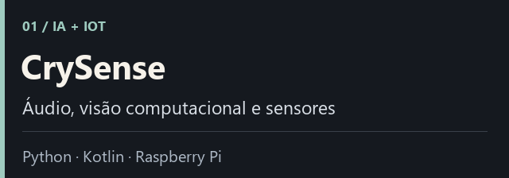
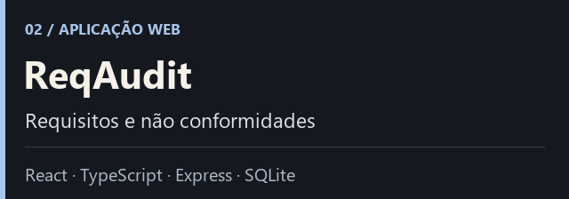
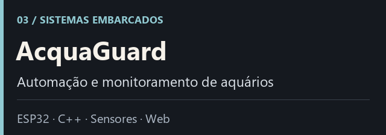
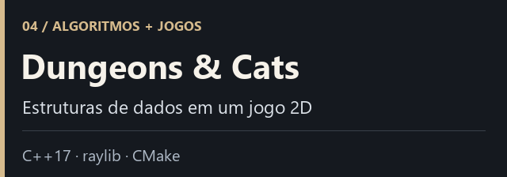

[**FYORA**](#produto-principal--fyora) · [**Projetos**](#projetos-em-destaque) · [**Tecnologias**](#tecnologias-e-áreas-de-atuação) · [**English**](#english-summary)

Desenvolvo aplicações web, APIs e sistemas conectados a hardware. Gosto de acompanhar o caminho completo: entender o problema, construir a solução, colocar no ar e evoluir o produto.

Sou o criador da **FYORA**, meu principal projeto: um SaaS que desenvolvi da concepção à operação. Meu portfólio também reúne projetos de inteligência artificial aplicada, Android, IoT e estruturas de dados.

## Produto principal — FYORA

Uma plataforma para profissionais e negócios com hora marcada. O cliente escolhe serviço, profissional e horário em uma página pública; o estabelecimento acompanha os agendamentos e a gestão pelo painel. O autoatendimento permite remarcar e cancelar pelo link, respeitando o prazo do atendimento.

| Produto e experiência | Engenharia e operação |
| :--- | :--- |
| Concepção do MVP e regras de negócio | Frontend React/Next.js e APIs NestJS |
| Interface responsiva com abordagem **mobile first** | PostgreSQL, Prisma e autenticação |
| Agenda, profissionais, serviços e gestão financeira | Integração com gateway de pagamento Asaas |
| Agendamento e autoatendimento por link | Publicação em nuvem, testes, monitoramento e backups |

**Em produção:** o MVP de agendamento por link. **Em homologação:** a evolução do atendimento com OpenAI e WhatsApp; essa etapa ainda não está disponível de forma geral.

**SaaS proprietário, de código fechado.** O repositório da FYORA é privado. Aqui apresento apenas o produto e suas tecnologias, sem divulgar código ou dados internos.

**[Conhecer a FYORA →](https://usefyora.com)**

## Projetos em destaque

<table>
<tr>
<td width="50%" valign="top">

Protótipo de monitoramento infantil com classificação experimental de áudio, sensores, vídeo e aplicativo Android. Integra software, aprendizado de máquina e hardware; não é um dispositivo de diagnóstico médico.

**[Explorar o projeto →](https://github.com/VantuilPJr/CrySense)**

</td>
<td width="50%" valign="top">

Aplicação para auditoria de requisitos e acompanhamento de não conformidades, com checklist, perfis de acesso, responsáveis, prazos e histórico.

**[Repositório →](https://github.com/VantuilPJr/ReqAudit)** · **[Demonstração →](https://req-audit.vercel.app)**

</td>
</tr>
<tr>
<td width="50%" valign="top">

Automação de aquários com seis relés, monitoramento de temperatura e pH, estimativas de consumo, regras de controle e painel web local.

**[Explorar o projeto →](https://github.com/VantuilPJr/AcquaGuard)**

</td>
<td width="50%" valign="top">

Jogo 2D que aplica grafos, pilhas, filas e listas encadeadas à geração de mapas, à navegação e ao inventário.

**[Explorar o projeto →](https://github.com/VantuilPJr/Dugeons-Cats)**

</td>
</tr>
</table>

## Tecnologias e áreas de atuação

| Área | Tecnologias utilizadas nos projetos |
| :--- | :--- |
| **Web e APIs** | TypeScript, JavaScript, React, Next.js, NestJS, Express, PHP |
| **Dados e nuvem** | PostgreSQL, Prisma, SQLite, MySQL, Neon, Google Cloud Run, Cloudflare |
| **IA aplicada** | Python, OpenAI API, scikit-learn, FastAPI, OpenCV/YOLO, Edge Impulse |
| **Mobile e embarcados** | Kotlin, Jetpack Compose, C++, Arduino, ESP32, Raspberry Pi |

### Outros projetos

| Projeto | O que construí |
| :--- | :--- |
| [**Gestão Escolar**](https://github.com/VantuilPJr/gestaoEscolar) | Aplicação desktop em Python/Tkinter para alunos, turmas, frequência, notas e gráficos. |
| [**CrySenseAI**](https://github.com/VantuilPJr/CrySenseAI) | Implementação ESP32 do protótipo CrySense, com firmware, painel React e componentes Python. |
| [**Plataforma de Apoio Escolar**](https://github.com/VantuilPJr/plataforma_apoio_escolar) | Projeto acadêmico em PHP/MySQL para alunos, professores e organizações. |
| [**Voilà Voyages**](https://github.com/VantuilPJr/agenciaViagens) | Interface acadêmica em HTML, CSS e JavaScript para uma agência de viagens fictícia. |

## Como trabalho

Parto do problema de quem usa o sistema e busco entregar um fluxo completo, com atenção à experiência, às regras do negócio e à manutenção. Uso IA como apoio ao desenvolvimento, à investigação e à revisão, verificando os resultados antes de incorporá-los ao produto.

Os repositórios públicos documentam objetivo, tecnologias, execução e limitações de cada projeto. Produtos comerciais, credenciais e dados privados permanecem separados do portfólio público.

## English summary

I build **full-stack products** and explore applied AI, Android and embedded systems. My main project is **FYORA**, a proprietary scheduling SaaS that I developed from product conception to deployment, including a mobile-first interface, APIs, PostgreSQL, payment integration and cloud operations.

FYORA’s link-based MVP is live. AI-assisted WhatsApp service is being developed separately and is not yet generally available. **Its source code remains private.** My public projects cover audio classification, computer vision, requirements auditing, aquarium automation and C++ data structures applied to a game.

---

[**Todos os repositórios públicos**](https://github.com/VantuilPJr?tab=repositories) · [**Conheça a FYORA**](https://usefyora.com)
